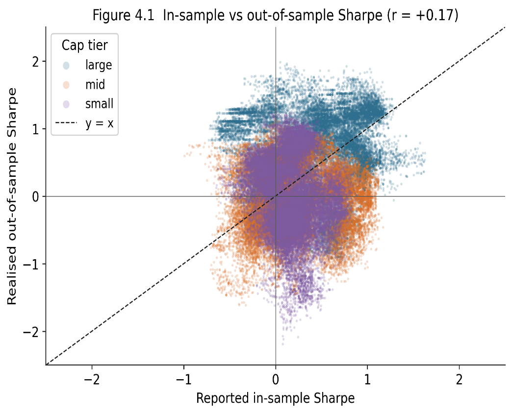
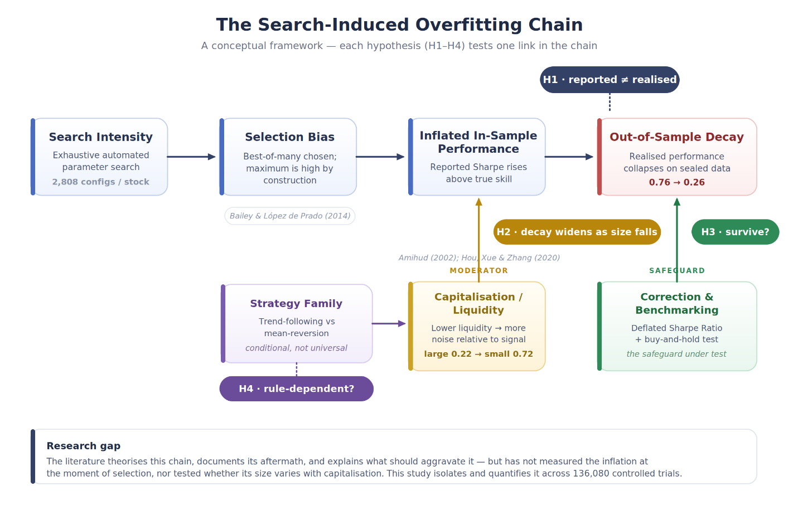

# The Capitalisation Gradient in Search-Induced Overfitting

**A controlled study of automated strategy search across US equities.**

MSc Business Analytics and Consultancy dissertation · Edinburgh Business School, Heriot-Watt University (Dubai) · 2026
Supervisor: Professor Wasim Ahmed

**[Read the full dissertation (PDF, 59 pages)](paper/Capitalisation_Gradient_Search_Induced_Overfitting_Dissertation.pdf)**

---

## The question

Automated trading tools search thousands of strategy settings and show you the best one. That best result is inflated by construction, because it is the winner of a large search that nobody discloses. Finance theory has said so for years. Nobody had measured **how much** the number is inflated at the moment of selection, or whether the inflation depends on the kind of stock.

This study measures both, under controlled conditions.

## What I found

An exhaustive search of **2,808 moving-average configurations** was run on each of **30 US stocks** (10 large-cap, 10 mid-cap, 10 small-cap), 2016 to 2025, giving 84,240 trials. The best configuration per stock was selected on the first 70% of the data and then tested on the sealed final 30%.

| What a practitioner would report | What actually happened out of sample |
|---|---|
| Mean Sharpe ratio of **0.76** | Fell to **0.26** |
| 30 strategies selected | **9 lost money** |
| | Only **5** survived a Deflated Sharpe correction for the search size |
| | Only **8** beat simply holding the stock |
| | **None** did both |
| Reported figure looks strong | For **11 of 30**, it was below what pure noise would produce from a search this size |

Across all 84,240 trials, the correlation between reported and realised performance was just **+0.17**.



*Each dot is one configuration. If the rule had real structure, dots would cluster along the dashed diagonal. They do not.*

### The capitalisation gradient (the original finding)

Under the trend-following rule, the damage grows as stocks get smaller:

| Tier | Reported Sharpe | Realised Sharpe | Drop | Reported-vs-realised correlation (all trials) |
|---|---:|---:|---:|---:|
| Large-cap | +0.91 | +0.69 | 0.22 | +0.12 |
| Mid-cap | +0.72 | +0.15 | 0.57 | +0.10 |
| Small-cap | +0.67 | −0.05 | 0.72 | **−0.15** |

In small-caps the correlation turns **negative**: a better-looking backtest pointed, on average, to *worse* out-of-sample performance. The best-fitting setting on a noisy series is the one most tuned to that series' accidents, so less of it carries over.

Spearman rank correlation between tier and realised performance: ρ = −0.44, p = 0.015. Dropping any single stock leaves it significant.

### Is it just this one rule? (robustness test)

The whole experiment was repeated with an opposite rule, an RSI mean-reversion strategy, across a further 51,840 trials (136,080 trials in total).

- **The inflation reproduced.** Reported Sharpe 0.90 fell to 0.10 out of sample.
- **The gradient did not.** ρ = −0.20, p = 0.29. So the gradient is a property of trend-following search, not a universal law.

I report that second result as it came out, rather than claiming a universal effect the data does not support.

### Sanity check on pure noise

Before running real prices, the same search was run on 30 synthetic random-walk series that contain no signal by construction. It still returned a mean reported Sharpe of **0.70**, which fell to 0.17 out of sample. The search manufactures the illusion, not the stocks.

## Statistical tests

| Claim | Test | Result |
|---|---|---|
| Reported performance exceeds realised | Wilcoxon signed-rank | W = 72, p = 0.0006 |
| Same, parametric check | Paired t-test | t = 4.07, p = 0.0003, Cohen's d = 0.74 |
| Mean drop of 0.50 | 95% confidence interval | 0.25 to 0.75 (excludes zero) |
| Performance differs by tier | Kruskal-Wallis | H = 6.02, p = 0.049 |
| Performance ordered by tier | Spearman rank | ρ = −0.44, p = 0.015 |

## A five-step checklist for judging any backtest

The practical output of the study, written for investors and advisers without institutional tools:

1. Ask how many configurations were tested. A result without its trial count cannot be interpreted.
2. Apply the Deflated Sharpe Ratio using that count.
3. Confirm the strategy was tested on genuinely unseen data.
4. Compare it against buy-and-hold in the same asset. If it does not beat that, it adds no value.
5. Make sure realistic transaction costs are included.

A claim that fails any one of the five should be treated as unproven.

## How the study was built

- **Design:** positivist, deductive, quantitative experiment. The parameter grid was fixed before any data was examined and never altered.
- **Data:** daily prices, 1 Jan 2016 to 31 Dec 2025, from Yahoo Finance via `yfinance`, adjusted for splits and dividends.
- **Split:** chronological, first 70% searched, final 30% sealed and never used in selection.
- **Costs:** 10 basis points on entry and exit, fixed and never tuned, so costs cannot become a hidden tuning knob.
- **Selection:** the highest in-sample Sharpe per stock, exactly as a practitioner would report it. Every other trial is kept, which allows the all-trials analysis.
- **Measures:** Sharpe, Sortino, maximum drawdown, Deflated Sharpe Ratio, buy-and-hold benchmark, expected-maximum-under-noise comparison.
- **Tools:** Python, `yfinance`, pandas, SciPy.



## Limitations

- One decade containing a long rising market, one country, 30 stocks, two rule families.
- Transaction costs are a flat 10 bps. Real costs are larger for small-caps, so a more realistic model would deepen the gradient, not remove it.
- The rules are deliberately naive, so the study speaks to the mechanism of search-induced inflation, not to whether sophisticated strategies can have genuine skill.
- The gradient depends on the trend-following rule and did not reproduce under mean reversion.
- Further implementation choices are listed in Section 3.9 of the paper.

The paper covers each of these in detail (Sections 3.8 and 6.5).

## Contents

```
paper/    Full dissertation (PDF)
assets/   Figures used in this README
```

The trial-level data and the Python search code are not in this repository.

## Citation

> Maheshwari, H. (2026). *The Capitalisation Gradient in Search-Induced Overfitting: A Controlled Study of Automated Strategy Search Across US Equities.* MSc dissertation, Heriot-Watt University, Dubai.

## Contact

Harshit Maheshwari · Dubai, UAE · harshit27200@gmail.com · [More projects](https://github.com/Harshit2705-ops)

*Academic research. Not investment advice. The strategies demonstrate a statistical mechanism and are not recommended for live trading.*
